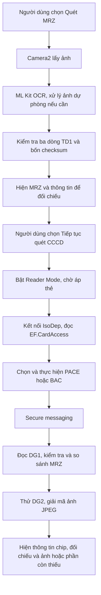

# Vietnamese Identity Chip Lab — Tìm hiểu quét MRZ và đọc chip CCCD trên Android

## Giới thiệu và mục đích

Vietnamese Identity Chip Lab là lab cá nhân của tôi để tìm hiểu cơ chế đọc căn cước công dân bằng NFC trên Android. Tôi thử nghiệm luồng quét MRZ bằng camera, kiểm tra dữ liệu theo ICAO Doc 9303, dùng MRZ để truy cập chip rồi đọc thông tin và ảnh chân dung.

Repo ghi lại những gì tôi đã tìm hiểu và thử được, cùng cách các thành phần camera, OCR và giao tiếp chip kết nối với nhau. Phạm vi hiện tại tập trung vào CCCD có MRZ TD1 và giao thức truy cập được thư viện hỗ trợ.

### Đôi lời về repo

May mà có Codex, Gemini, Google và Claude hỗ trợ trong quá trình tìm tài liệu, nghiên cứu và thử nghiệm. Toàn bộ mã ứng dụng trong repo được viết bằng AI; tôi đưa yêu cầu, chạy thử và điều chỉnh dựa trên kết quả thực tế, nên chắc chắn vẫn còn những thiếu sót.

Tôi chia sẻ repo này chỉ để ghi lại quá trình tìm hiểu cơ chế đọc CCCD qua NFC trên Android. Người sử dụng tự chịu trách nhiệm về cách dùng project và việc tuân thủ pháp luật. Tôi không chịu trách nhiệm đối với việc dùng project vào các hành vi vi phạm pháp luật.

Các nền tảng và thư viện được tích hợp có tác giả riêng: .NET/Android, Google ML Kit, Emrtd, AndroidX và xUnit. Mã ứng dụng điều phối các thành phần này; thuật toán PACE/BAC và secure messaging do thư viện Emrtd thực hiện.

## Các chuẩn được áp dụng

| Chuẩn/cơ chế | Phần được sử dụng | Thành phần chịu trách nhiệm |
| --- | --- | --- |
| ICAO Doc 9303, Part 3 và Part 5 | Quy tắc MRZ chung và cấu trúc TD1 ba dòng × 30 ký tự; trường số giấy tờ, ngày, họ tên và chữ số kiểm tra | `Td1Mrz`, `MrzAccess` |
| ICAO Doc 9303, Part 10 — LDS | Tổ chức và phân tích dữ liệu DG1/DG2 trong chip | `IcaoChipSession` cùng `Emrtd.Lds` |
| ICAO Doc 9303, Part 11 | Truy cập bằng BAC/PACE, dẫn xuất đầu vào khóa và secure messaging trong tập giao thức được hỗ trợ | `Emrtd` và lớp kiểm soát phiên |
| ISO/IEC 14443 Type A/B, Part 4 | Giao tiếp thẻ không tiếp xúc qua IsoDep | Phần cứng NFC, Android `NfcAdapter`/`IsoDep` |
| ISO/IEC 7816-4 | Command/response APDU, chọn ứng dụng/tệp, đọc dữ liệu và mã trạng thái SW | `Emrtd` tạo/xử lý lệnh; `IsoDepTransport` truyền byte |
| NFC Forum NDEF/RTD | Giải mã record Text/URI trong module độc lập còn giữ trong mã | `Features/Ndef`; không tham gia luồng CCCD trên màn hình chính |

Đây là phạm vi tham chiếu và áp dụng trong mã, không phải chứng nhận tuân thủ toàn bộ các chuẩn. Camera, OCR, crop ảnh, nhịp quét và cách chuyển màn hình là chính sách ứng dụng; ICAO không quy định phải dùng ML Kit hoặc phải nhận dạng sau một số frame cố định.

## Công nghệ và thành phần

### Công nghệ chính

| Công nghệ | Vai trò | Nơi sử dụng |
| --- | --- | --- |
| C# và .NET 10 cho Android | Nền tảng chạy ứng dụng, truy cập Android API và liên kết các module | `VietnameseIdentityChipLab`, target `net10.0-android`, min API 23 |
| .NET 10 thuần C# | Chứa quy tắc TD1 và kiểm soát trạng thái phiên độc lập với Android | `Icao9303.Core`, target `net10.0` |
| Google ML Kit Text Recognition, model Latin đóng gói | Chuyển ảnh thành dòng chữ và tọa độ OCR ngay trên thiết bị | Gói `Xamarin.Google.MLKit.TextRecognition` 116.0.1.9 |
| Android NFC Reader Mode và IsoDep | Phát hiện thẻ, mở kết nối và trao đổi byte APDU | `Features/Nfc`, `IsoDepTransport` |
| Emrtd 0.1.0 | PACE/BAC, khóa phiên, MAC, secure messaging và phân tích LDS | `IcaoChipSession`, `Features/Chip` |

### Công nghệ hỗ trợ theo bước xử lý

| Bước | Công nghệ hỗ trợ | Công việc cụ thể |
| --- | --- | --- |
| Lấy ảnh | Camera2, `TextureView`, `ImageReader`, YUV | Preview, nhận frame và lấy kênh sáng Y |
| Xử lý ảnh | `Android.Graphics.Bitmap`, `Canvas`, phép tính pixel C# | Xoay hướng, crop, chỉnh nghiêng nhỏ và adaptive mean threshold |
| Xác định vùng MRZ | Bounding box/góc dòng từ ML Kit và `MrzRegionDetector` | Tìm nhóm dòng có dạng MRZ; không thấy vùng thì giữ toàn ảnh |
| Điều phối OCR | `HandlerThread`, `Handler`, callback ML Kit và khóa đồng bộ | Xử lý một frame tại một thời điểm, giải phóng ảnh sau khi hoàn tất |
| Kiểm tra và định dạng | `Td1Mrz`, `MrzAccess`, `MrzResultFormatter` | Kiểm tra khuôn dạng/checksum; hiển thị trường dữ liệu; không tự sửa ký tự |
| Tạo đầu vào truy cập | `System.Security.Cryptography`, ASCII và `Emrtd.MrzKey` | Tạo/đối chiếu `MRZ_information`; SHA-1 dùng trong quy trình MRZ |
| Đọc dữ liệu và trình bày | `ImmutableArray`, `BitmapFactory`, `ImageView` | Giữ byte LDS, phân tích DG1/DG2, hiển thị JPEG |
| Giao diện và tương thích | Android `Activity`, widget native và AndroidX Core 1.19.0.1 | Hai vùng MRZ/CCCD, quyền thiết bị và trạng thái ngắn |
| Kiểm thử/build | xUnit 2.9.3, Microsoft.NET.Test.Sdk 17.14.1, .NET CLI, Android SDK/JDK | Kiểm thử logic, biên dịch, đóng gói và kiểm tra APK |

Ứng dụng không dùng ML Kit Document Scanner, OpenCV hoặc SkiaSharp. Model OCR được đóng gói trong APK; Manifest loại quyền Internet. Ảnh, MRZ và kết quả chip được giữ trong bộ nhớ trong phiên sử dụng.

### Thành phần chính và thành phần phụ

Thành phần chính chịu trách nhiệm cho các bước người dùng phải đi qua. Thành phần phụ hỗ trợ xử lý, định dạng, quản lý tài nguyên hoặc kiểm chứng; chúng không thay điều kiện xác nhận MRZ hay xác thực chip.

| Nhóm | Thành phần | Trách nhiệm |
| --- | --- | --- |
| Chính | [App/MainActivity](VietnameseIdentityChipLab/App/README.md) | Điều khiển vùng MRZ và vùng CCCD; nhận thao tác người dùng; trình bày kết quả |
| Chính | [Features/Mrz](VietnameseIdentityChipLab/Features/Mrz/README.md) | Camera/OCR, chọn ba dòng MRZ, đối chiếu và xác nhận |
| Chính | [Icao9303.Core](Icao9303.Core/README.md) | Quy tắc TD1, đầu vào khóa, điều kiện xác thực và đọc DG |
| Chính | [Features/Nfc](VietnameseIdentityChipLab/Features/Nfc/README.md) | Reader Mode, nhận Tag, phiên quét và hủy callback cũ |
| Chính | [Features/Chip](VietnameseIdentityChipLab/Features/Chip/README.md) | Cầu nối IsoDep, chọn PACE/BAC, đọc và so sánh dữ liệu chip |
| Phụ | `MrzRegionDetector`, `ImagePreprocessor`, `MrzImageMath` | Tìm vùng chữ và cải thiện ảnh khi OCR ban đầu chưa hợp lệ |
| Phụ | `MrzScanDecision`, `MrzResultFormatter`, `ChipMrzResult` | Chính sách dừng, định dạng trường và phân loại kết quả |
| Phụ | [Properties](VietnameseIdentityChipLab/Properties/README.md), quản lý generation/bitmap | Quyền phần cứng, vòng đời và quyền sở hữu tài nguyên |
| Phụ | [Icao9303.Core.Tests](Icao9303.Core.Tests/README.md) | Kiểm tra các bất biến mà không cần điện thoại |
| Độc lập | [Features/Ndef](VietnameseIdentityChipLab/Features/Ndef/README.md) | Module NDEF phục vụ phạm vi riêng; không được gọi khi đọc CCCD |

## Luồng tổng quát từ MRZ đến chip



MRZ đọc qua camera là dữ liệu đầu vào để truy cập chip. Thông tin hiển thị sau NFC phải lấy từ byte DG1/DG2 thực sự đọc được. Việc hai nguồn khớp nhau là một kết quả đối chiếu; không dùng lại bản camera để giả kết quả đọc chip.

### Quy trình quét MRZ

1. **Mở camera:** xin quyền khi nhấn quét; chọn camera sau và kích thước chung preview/YUV gần 1080p. Scanner chỉ xử lý một frame, khoảng cách bắt đầu tối thiểu 200 ms.
2. **Nhận dạng ban đầu:** ML Kit đọc toàn khung để nhận nhanh ảnh rõ và lấy tọa độ dòng chữ. Nếu đã có TD1 hợp lệ thì không cần các lượt xử lý dự phòng.
3. **Xử lý dự phòng:** tìm nhóm hai/ba dòng giống MRZ; lấy kênh Y thành ảnh xám, xoay hướng, crop có lề và chỉnh nghiêng tối đa ±8°. Thử OCR ảnh xám rồi ảnh threshold. Không tìm thấy vùng thì dùng toàn khung; tối đa ba lượt OCR tuần tự mỗi frame.
4. **Kiểm tra:** tìm ba dòng liền nhau, bỏ space/tab OCR chèn trong dòng. Lõi kiểm tra 30 ký tự mỗi dòng và bốn chữ số kiểm tra. Không tự thay `O/0`, ghép dòng hoặc bù ký tự.
5. **Dừng và đối chiếu:** một frame hợp lệ đủ để tự dừng. **Chụp thủ công** dừng sau frame tiếp theo, kể cả chưa hợp lệ; **Dừng quét** giữ bản có chữ mới nhất đã hoàn tất. Bản chưa hợp lệ chỉ được sửa, chưa được dùng cho NFC.
6. **Xác nhận:** hiển thị chuỗi và các trường thông tin. Chỉ sau khi người dùng chọn **Tiếp tục quét CCCD**, ứng dụng kiểm tra lại rồi giữ `Td1Mrz` đã xác nhận và chuyển vùng hiển thị.

Chi tiết tài nguyên và API: [module MRZ](VietnameseIdentityChipLab/Features/Mrz/README.md), contract C01–C04 trong [quy trình nội bộ](docs/quy-trinh-va-contract.md).

### Quy trình đọc dữ liệu chip

1. **Chờ CCCD:** kiểm tra adapter/NFC và bật `NfcA | NfcB | SkipNdefCheck`. Luồng CCCD không yêu cầu thẻ có dữ liệu NDEF.
2. **Kết nối:** nhận `Tag`, lấy `IsoDep`, mở transport và đặt timeout 10 giây. Chỉ xử lý một callback thẻ đang đọc.
3. **Chọn giao thức:** đọc EF.CardAccess, chọn PACE Generic Mapping được chip công bố và thư viện hỗ trợ. Không có PACE phù hợp hoặc CardAccess bị từ chối thì thử BAC.
4. **Xác thực truy cập:** tạo đầu vào từ trường số giấy tờ chín ký tự, ngày sinh/ngày hết hạn và các checksum tương ứng. Đối chiếu đầu vào với `Emrtd.MrzKey`, rồi để thư viện thực hiện PACE/BAC và tạo secure messaging. Không thử BAC trong cùng phiên sau PACE đã bắt đầu rồi lỗi.
5. **Đọc DG1:** nhận byte LDS qua kênh bảo vệ, giải mã ba dòng MRZ, kiểm tra TD1 rồi so sánh đủ ba dòng với bản đã xác nhận, kể cả họ tên.
6. **Thử DG2:** đọc ảnh chân dung; hiển thị JPEG nếu giải mã được. Thiếu ảnh, định dạng chưa hỗ trợ hoặc lỗi đọc ảnh không làm mất thông tin DG1 đã đọc.
7. **Kết thúc:** dừng Reader Mode, hiển thị kết quả khớp/khác và thông tin/ảnh thực có. Thử lại bằng **Quét lại CCCD** sau khi nhấc thẻ; **Quay lại MRZ** hủy phiên, giữ chuỗi để đối chiếu lại.

Chi tiết giao thức và công thức đầu vào: [khóa và phiên chip](docs/quy-trinh-key-va-giai-ma.md). Chi tiết xử lý thiết bị: [module NFC](VietnameseIdentityChipLab/Features/Nfc/README.md) và [module Chip](VietnameseIdentityChipLab/Features/Chip/README.md).

## Phương thức giao tiếp giữa các bước

Các module giao tiếp nội bộ bằng lời gọi C#, callback và đối tượng dữ liệu. Chỉ đường `IsoDep.Transceive` trao đổi byte với phần cứng thẻ; không có REST API hoặc máy chủ trong luồng này.

| Ranh giới | Phương thức | Dữ liệu/điều kiện chính | Contract chi tiết |
| --- | --- | --- | --- |
| Camera → scanner | Callback `OnImageAvailable` | `Image` YUV và góc xoay; ảnh giữ mở đến khi OCR xong | C01 |
| OCR → tiền xử lý | Lời gọi helper và listener ML Kit | Dòng chữ/tọa độ → `MrzImageRegion` → bitmap riêng | C02 |
| Scanner → điều phối MRZ | `Action<string, bool>` | Văn bản OCR và cờ chụp thủ công; lỗi qua callback riêng | C03 |
| Bản sửa → lõi TD1 | `MrzAccess.TryPrepare` | `string` → `Td1Mrz` hoặc false/lỗi; không tự sửa OCR | C04 |
| MRZ đã xác nhận → NFC | `BeginCccdScan`, `OnTagDiscovered` | `Td1Mrz` + `Tag`; generation phải còn hiện hành | C05 |
| Phiên chip ↔ transport | `ICardTransport.Transmit` | Command APDU `byte[]` ↔ response `byte[]` gồm SW | C06 |
| Điều phối → phiên ICAO | Các hàm xác thực/đọc của `IcaoChipSession` | Chỉ đọc DG sau khi có secure messaging | C07 |
| DG1 → thông tin | `DecodeDg1`, `ChipMrzResult.FromDg1` | Byte LDS → MRZ từ chip + `MatchesConfirmed` | C08 |
| DG2 → ảnh | `DecodeDg2`, `BitmapFactory` | MIME/byte ảnh → bitmap hoặc không hiển thị được | C09 |
| Kết quả → UI | `RunOnUiThread`, cập nhật đúng generation | Thông báo ngắn, trường dữ liệu và ảnh | C10 |

Định nghĩa đầy đủ của C01–C10, lỗi và quyền sở hữu tài nguyên nằm trong [quy trình và contract](docs/quy-trinh-va-contract.md). Pixel work chạy trên handler ảnh; công việc đọc chip xuất phát từ callback NFC. UI được cập nhật trên main thread. Mỗi lần quét có generation riêng để callback cũ không ghi đè kết quả mới.

Sửa MRZ, quét giấy tờ mới hoặc quay lại MRZ hủy đầu vào NFC đã xác nhận và kết quả chip cũ. Ra nền dừng camera/phiên NFC; quay lại cần chủ động quét lại. Dữ liệu không được cam kết lưu qua lần Activity bị tạo lại.

## Setup môi trường

Solution: [Vietnamese Identity Chip Lab.sln](<Vietnamese Identity Chip Lab.sln>), gồm ứng dụng `VietnameseIdentityChipLab`, thư viện `Icao9303.Core` và bộ test `Icao9303.Core.Tests`. Có thể mở solution trong Visual Studio hoặc dùng các lệnh CLI bên dưới.

Tên hiển thị ứng dụng là **Vietnamese Identity Chip Lab**. Android Application ID vẫn là `vn.hoctap.nfcreader` để bản đổi tên có thể cài cập nhật lên ứng dụng hiện có; tên APK vì vậy vẫn theo ID này.

### 1. Chuẩn bị công cụ và thiết bị

Cần .NET SDK 10, workload `android`, Android SDK/JDK và điện thoại Android API 23 trở lên có camera/NFC. Máy hiện dùng SDK .NET 10.0.402. Chạy các lệnh sau từ thư mục gốc dự án:

```powershell
dotnet --info
dotnet workload list
```

Nếu chưa có workload Android, cài bằng:

```powershell
dotnet workload install android
```

### 2. Chuẩn bị Android SDK và JDK

Workspace sử dụng `.android-sdk` và `.android-jdk`, đã bỏ qua trong Git. Nếu chưa có, tải công cụ bằng target cài dependency; `AcceptAndroidSDKLicenses=True` chấp nhận giấy phép Android SDK:

```powershell
dotnet build .\VietnameseIdentityChipLab\VietnameseIdentityChipLab.csproj -t:InstallAndroidDependencies `
  -p:AndroidSdkDirectory="$PWD\.android-sdk" `
  -p:JavaSdkDirectory="$PWD\.android-jdk" `
  -p:AcceptAndroidSDKLicenses=True
```

Nếu dùng SDK/JDK đã cài ở nơi khác, thay hai đường dẫn trong các lệnh setup/build tương ứng. Không cần cài OCR server hoặc tải model trên điện thoại khi quét.

### 3. Khôi phục package và build

```powershell
dotnet restore .\VietnameseIdentityChipLab\VietnameseIdentityChipLab.csproj

dotnet build .\VietnameseIdentityChipLab\VietnameseIdentityChipLab.csproj -c Release `
  -p:AndroidSdkDirectory="$PWD\.android-sdk" `
  -p:JavaSdkDirectory="$PWD\.android-jdk"
```

APK đầu ra: `VietnameseIdentityChipLab/bin/Release/net10.0-android/vn.hoctap.nfcreader-Signed.apk`.

### 4. Cài và chạy trên điện thoại

Có thể chuyển APK sang điện thoại để cài. Nếu dùng USB/ADB, bật chế độ nhà phát triển và USB debugging, kết nối điện thoại rồi chạy:

```powershell
.\.android-sdk\platform-tools\adb.exe devices
.\.android-sdk\platform-tools\adb.exe install -r `
  .\VietnameseIdentityChipLab\bin\Release\net10.0-android\vn.hoctap.nfcreader-Signed.apk
```

Nếu có nhiều thiết bị, thêm `-s <serial>` trước `install`. Mở **Vietnamese Identity Chip Lab**, cấp quyền camera khi quét và bật NFC. Không cần Internet cho luồng đọc.

## Test và kiểm chứng

### Kiểm thử tự động

```powershell
dotnet test .\Icao9303.Core.Tests\Icao9303.Core.Tests.csproj -c Release
```

Bộ hiện tại có 21 ca: đầu vào khóa/hash mẫu ICAO, ký tự đệm, ranh giới OCR, chấp nhận một frame, bản thủ công, crop/threshold, điều kiện phiên, DG1 sai/khác và kết quả thiếu ảnh. Chi tiết tại [README test](Icao9303.Core.Tests/README.md). Lần kiểm chứng gần nhất của phiên bản mã hiện tại: 21/21 đạt, build Release không lỗi/cảnh báo.

### Kiểm thử luồng trên điện thoại

1. Quét MRZ rõ; kiểm tra camera dừng, chuỗi/thông tin xuất hiện và nút tiếp tục bật. Với bản sai/thiếu, phải sửa hoặc quét lại trước khi tiếp tục.
2. Chọn **Tiếp tục quét CCCD**; kiểm tra chỉ vùng CCCD hiện, có trạng thái chờ và không đi sang NDEF.
3. Áp thẻ và giữ yên; kiểm tra thông tin từ chip, đối chiếu MRZ, ảnh hoặc thông báo phần chưa đọc được.
4. Thử NFC tắt, nhấc thẻ giữa chừng, quay lại MRZ và đưa app ra nền; phiên cũ phải dừng, không làm xuất hiện lại kết quả/ảnh đã hủy.

[Tài liệu kiểm chứng](docs/kiem-thu.md) giữ bảng tình huống đầy đủ, lệnh kiểm tra chữ ký/quyền APK và phạm vi bằng chứng. Người dùng đã phản hồi đọc NFC thành công; kiểm thử tự động không thay kiểm tra trên từng thiết bị/thẻ.

## Phạm vi và giới hạn

Luồng chính hỗ trợ TD1 ba dòng × 30 ký tự trong tập kiểm tra hiện có, số giấy tờ nằm trong trường chín ký tự và hai ngày đủ sáu chữ số. Chưa hỗ trợ TD3, số giấy tờ TD1 kéo dài hoặc hiển thị JPEG 2000. Parser không xác minh đầy đủ mã quốc gia, ngày lịch thực tế hay thế kỷ; checksum không bảo vệ mọi ký tự như họ tên.

Không đọc DG3/DG4 và không xác minh SOD/chuỗi CSCA. Đọc chip thành công hoặc MRZ khớp không chứng minh giấy tờ thật. Không đặt cam kết tốc độ/độ chính xác từ số test pass. Màn hình chính tối giản, không hiện raw/APDU, khóa, hash hoặc bảng bước kỹ thuật.

## Cách đọc bộ tài liệu

| Mức | Tài liệu | Mục đích |
| --- | --- | --- |
| Tổng quan | README này | Mục đích học tập, chuẩn, công nghệ chính/phụ, luồng và setup/test |
| Giao tiếp | [Quy trình và contract](docs/quy-trinh-va-contract.md) | Dữ liệu, tiền điều kiện, đầu ra, lỗi và tài nguyên từng bước |
| Chuẩn/giao thức | [Khóa và phiên chip](docs/quy-trinh-key-va-giai-ma.md) | Vị trí trường MRZ, đầu vào khóa, PACE/BAC và LDS |
| Kiểm chứng | [Kiểm thử](docs/kiem-thu.md) | Cách kiểm tra tự động, APK và hành vi thiết bị |
| Mã nguồn | [Android](VietnameseIdentityChipLab/README.md), [lõi ICAO](Icao9303.Core/README.md), README từng module | Trách nhiệm và API theo folder |
| Mục lục | [Tài liệu hệ thống](docs/README.md) | Thứ tự đọc và quy tắc cập nhật để tài liệu không mâu thuẫn |

Các tài liệu chi tiết hiện có được giữ và kết nối theo cấu trúc này. README giải thích bức tranh chung; contract là nguồn chính cho giao tiếp; tài liệu khóa là nguồn chính cho đầu vào truy cập và phiên chip.
