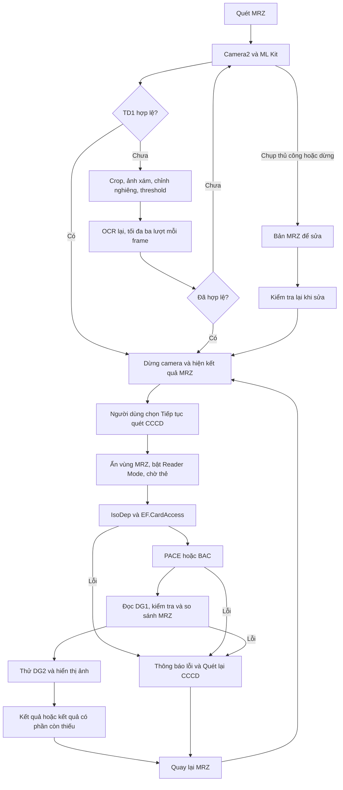

# Quy trình xử lý và contract nội bộ

## Vai trò

Tài liệu này định nghĩa giao tiếp và điều kiện chuyển bước của luồng chính từ camera đến kết quả chip. Đọc [tổng quan dự án](../README.md) trước để hiểu mục đích học tập, chuẩn, công nghệ chính/phụ và setup/test. Chuỗi MRZ hiển thị sau OCR và thông tin đọc từ chip là hai nguồn dữ liệu riêng. Chỉ thao tác **Tiếp tục quét CCCD** mới xác nhận bản MRZ và bắt đầu chờ NFC.

## Quy trình từng bước

Nhánh sửa chỉ đến kết quả hợp lệ khi nội dung vượt kiểm tra TD1; nếu chưa hợp lệ thì nút tiếp tục bị vô hiệu. Sau OCR, việc hiển thị không tự xác nhận đầu vào NFC.

| Bước | Xử lý | Đầu ra | Điều kiện chuyển tiếp |
| --- | --- | --- | --- |
| 1. Camera | Xin quyền khi người dùng quét; mở camera sau, chọn kích thước chung preview/YUV gần 1080p | Preview và `Image` YUV | Camera mở được và frame được chọn để xử lý |
| 2. OCR | Nhận dạng toàn khung trước; nếu cần tìm vùng chữ và thử ảnh xám/nhị phân | Văn bản OCR của một frame | Tối đa ba lượt OCR tuần tự; một frame đang xử lý |
| 3. Chọn MRZ | Tìm ba dòng liền nhau, bỏ space/tab OCR chèn trong dòng, kiểm tra TD1 | Chuỗi MRZ hợp lệ hoặc bản để sửa thủ công | Tự dừng từ một frame hợp lệ; bản tự động chưa hợp lệ tiếp tục quét |
| 4. Đối chiếu | Hiện chuỗi và các trường; cho người dùng sửa | `Td1Mrz` khi kiểm tra thành công | Người dùng chọn **Tiếp tục quét CCCD** |
| 5. Chờ thẻ | Ẩn vùng MRZ, hiện vùng CCCD; bật NFC-A/B với `SkipNdefCheck` | `Tag` Android | Một callback thẻ tại một thời điểm và phiên còn hiện hành |
| 6. Truy cập chip | Kết nối IsoDep; đọc CardAccess; chọn PACE Generic Mapping phù hợp hoặc BAC | Phiên secure messaging | Xác thực thành công; không chuyển BAC sau PACE đã bắt đầu rồi lỗi |
| 7. Thông tin | Đọc DG1, giải mã, kiểm tra TD1 và so sánh đủ ba dòng | `ChipMrzResult` | DG1 phải hợp lệ; không dùng lại bản camera làm dữ liệu chip |
| 8. Ảnh/kết quả | Thử DG2, giải mã JPEG nếu có; dừng Reader Mode | Thông tin chip, khớp/khác MRZ, ảnh hoặc lý do chưa có ảnh | Thất bại DG2 vẫn giữ DG1 đã đọc |

## Contract giữa các bước

### C01 — Camera → frame OCR

Nguồn: [`LiveMrzScanner`](../VietnameseIdentityChipLab/Features/Mrz/LiveMrzScanner.cs), `OnImageAvailable(ImageReader?)`.

Đầu vào là `Image` YUV từ camera sau và góc xoay cảm biến/màn hình. Scanner lấy ảnh mới nhất, chỉ giữ một frame đang xử lý; khoảng cách giữa hai lần bắt đầu tối thiểu 200 ms. Ảnh bị bỏ qua được đóng ngay. Frame được nhận giữ mở tới khi toàn bộ OCR và retry hoàn tất.

### C02 — OCR ban đầu → vùng ảnh và OCR dự phòng

API: `MrzRegionDetector.TryFind(IEnumerable<MrzOcrLine>, int width, int height, out MrzImageRegion)`.

`MrzOcrLine` chứa nguyên văn dòng, bounding box và góc trong hệ tọa độ ảnh đã xoay thẳng. `MrzImageRegion` chứa `Left`, `Top`, `Width`, `Height`, `AngleDegrees`. Khi tìm được nhóm hai/ba dòng tương tự MRZ, vùng được thêm lề và giới hạn trong ảnh. `false` nghĩa dùng toàn khung, không tự cắt phần cuối camera.

`ImagePreprocessor.FromCameraLuma(Image, int rotation)` tạo bitmap xám từ kênh Y với row/pixel stride. `Process(Bitmap, MrzImageRegion, bool binarize)` tạo bitmap riêng để crop/chỉnh nghiêng tối đa ±8° và tùy chọn threshold. Caller sở hữu bitmap trả về, không được giải phóng trước khi ML Kit đọc xong. Pixel work chạy trên handler ảnh; listener ML Kit trả kết quả về scanner. Không có phát hiện biên thẻ, sửa phối cảnh hoặc model Document Scanner trong contract này.

### C03 — Scanner → điều phối MRZ

Callback: `Action<string, bool> onText`, với `raw` là văn bản OCR và `manual` cho biết frame được yêu cầu chụp thủ công. Hai callback lỗi riêng là `onFatalError` và `onRecognitionError`.

`MrzScanDecision.ShouldStop(raw, manual, out draft)` trả `true` ngay khi chọn được TD1 hợp lệ; hoặc khi người dùng chụp thủ công dù bản chưa hợp lệ. Thủ công không nới kiểm tra NFC. Lượt tiền xử lý kém hơn không được thay bản hữu ích hơn của cùng frame. `Dừng quét` dùng bản có chữ mới nhất đã hoàn tất, không đợi frame mới. UI không hiển thị OCR thô liên tục; ô sửa chỉ nhận các dòng có dạng MRZ.

### C04 — Ô MRZ → dữ liệu đã xác nhận

API: `MrzAccess.TryPrepare(string editedText, out Td1Mrz? mrz, out string error)`.

`true` bảo đảm `mrz` khác null, đúng ba dòng × 30 ký tự, đủ bốn chữ số kiểm tra và thuộc tập TD1 hiện hỗ trợ. `false` trả `mrz = null` cùng mô tả lỗi. Adapter chỉ chuẩn hóa xuống dòng và bỏ một newline cuối; không tự thay `O/0`, ghép dòng hoặc bù ký tự.

`UpdateMrzDetails` có thể kiểm tra để trình bày trước khi người dùng xác nhận, nhưng không gán `_preparedMrz`. Chỉ nút **Tiếp tục quét CCCD** kiểm tra lại rồi gán đối tượng đã xác nhận và gọi `BeginCccdScan()`. Sửa văn bản luôn hủy `_preparedMrz` và phiên NFC cũ. Năm hiển thị giữ hai chữ số vì MRZ không cung cấp thế kỷ.

### C05 — Đã xác nhận MRZ → phiên NFC

API: `BeginCccdScan()` và `OnTagDiscovered(Tag?)` trong [`MainActivity.Nfc`](../VietnameseIdentityChipLab/Features/Nfc/MainActivity.Nfc.cs).

Tiền điều kiện là `_preparedMrz != null`. Adapter phải tồn tại, NFC phải bật và Activity ở trạng thái resumed. Reader Mode dùng `NfcA | NfcB | SkipNdefCheck`; CCCD không cần NDEF. Nhánh chính chỉ lấy `IsoDep.Get(tag)`; nếu thiếu IsoDep thì báo lỗi kết nối, không chuyển sang `ReadNdefTag`.

`_reading` bảo đảm một callback thẻ đang xử lý. `_nfcGeneration` xác định lần quét; mọi cập nhật UI/ảnh phải qua kiểm tra phiên còn hiện hành. Phiên mới không được bắt đầu đọc đồng thời với callback cũ chưa kết thúc.

### C06 — Phiên ICAO ↔ Android IsoDep

API: `ICardTransport.Transmit(byte[] apdu) → byte[] response`, hiện thực bởi [`IsoDepTransport`](../VietnameseIdentityChipLab/Features/Chip/IsoDepTransport.cs).

Command APDU phải có ít nhất bốn byte và không vượt `MaxTransceiveLength`. Response gồm byte dữ liệu và hai byte trạng thái cuối `SW1/SW2`; dưới hai byte là lỗi truyền. Mỗi lệnh chỉ gọi `Transceive` một lần; không tự retry APDU bảo vệ, không tự gửi plain GET RESPONSE. Thư viện `Emrtd` sở hữu sequence counter, MAC và secure messaging.

Transport đặt timeout 10 giây sau kết nối và đóng IsoDep khi dispose. `Reset()` bị từ chối; muốn xác thực lại phải nhấc và áp thẻ để tạo phiên mới. Màn hình chính không hiển thị APDU/hex.

### C07 — Truy cập chip → dữ liệu LDS

API: `IcaoChipSession.ReadCardAccess()`, `AuthenticatePace(Td1Mrz, PaceInfo)`, `AuthenticateBac(Td1Mrz)`, `ReadDg1Raw()`, `ReadDg2Raw()`.

Trước xác thực, ứng dụng đọc CardAccess và chọn giao thức. PACE chỉ nhận biến thể thư viện hỗ trợ và Generic Mapping; trường hợp không có PACE phù hợp dùng BAC. Trước khi gửi lệnh xác thực, dữ liệu khóa của `Emrtd.MrzKey` phải trùng `Td1Mrz.MrzInformation`.

Mỗi phiên chỉ thử xác thực một lần; sau xác thực thất bại không đọc DG hoặc thử giao thức khác trong cùng phiên. DG chỉ đọc khi `_secure` đã được bật. DG1 là `ImmutableArray<byte>`; DG2 là `ImmutableArray<byte>?`, null nghĩa chưa có nội dung để giải mã. Đây là byte LDS sau khi tháo secure messaging, không phải ciphertext trên sóng NFC.

### C08 — DG1 → kết quả thông tin

API: `IcaoChipSession.DecodeDg1(...) → ImmutableArray<string>` và `ChipMrzResult.FromDg1(IEnumerable<string>, Td1Mrz confirmed)`.

Đầu ra `ChipMrzResult` gồm `Mrz: Td1Mrz` lấy từ chip và `MatchesConfirmed: bool`. Chỉ tạo đối tượng khi dữ liệu chip có đúng ba dòng và vượt kiểm tra TD1. So sánh đủ ba dòng, gồm họ tên; khác tên vẫn phải báo khác dù checksum hợp lệ. DG1 thiếu/sai làm dừng bước đọc thông tin, không được báo thành công bằng cách dùng bản camera thay thế.

### C09 — DG2 → ảnh và kết quả có phần còn thiếu

API: `DecodeDg2(...) → Dg2Image?`, gồm `MimeType` và `ImmutableArray<byte> Bytes`.

JPEG được đưa qua `BitmapFactory.DecodeByteArray`. Chỉ bitmap giải mã thành công mới được gán cho ImageView và tính là ảnh hiển thị được. JPEG 2000, nội dung không nhận diện, null và lỗi đọc được báo riêng. DG1 đã thành công vẫn được giữ khi DG2 thất bại. Đối tượng bitmap gán cho UI do Activity sở hữu; bitmap từ callback phiên cũ phải được giải phóng ngay.

### C10 — Kết quả/lỗi → màn hình chính

`UpdateNfcProgress` hiển thị một thông báo ngắn và vòng chờ. `FinishNfcScan` dừng Reader Mode, giữ dữ liệu đọc được và hiện nút **Quét lại CCCD**. Bảng bước kỹ thuật chỉ còn ở chẩn đoán nội bộ, không xuất hiện trên màn hình. Kết quả phân biệt: thông tin và ảnh đã có; chỉ có thông tin; thông tin khác MRZ; hoặc lỗi tại bước hiện hành.

**Quay lại MRZ** hủy phiên, xóa thông tin/ảnh chip cũ và xóa đầu vào NFC đã xác nhận, nhưng giữ chuỗi trong ô MRZ. Người dùng phải chọn tiếp tục một lần nữa. Lỗi không được diễn giải thành kết luận giấy tờ giả hoặc MRZ chắc chắn sai.

## Hủy phiên và tài nguyên

| Sự kiện | Trạng thái phải hủy | Dữ liệu có thể giữ |
| --- | --- | --- |
| Sửa MRZ hoặc bắt đầu quét MRZ mới | Đầu vào đã xác nhận, Reader Mode, kết nối đang giữ, kết quả/ảnh chip | Chuỗi đang sửa; quét mới sẽ đặt lại nội dung |
| Quay lại MRZ | Phiên NFC và đầu vào đã xác nhận | Chuỗi MRZ để đối chiếu lại |
| Activity ra nền | Camera và phiên NFC đang chạy; vô hiệu callback cũ | MRZ đã xác nhận cho phép nhấn quét lại khi quay lại |
| Kết quả hoặc lỗi NFC | Reader Mode; đóng transport khi thao tác kết thúc | Kết quả cuối và thông tin DG1 nếu đã đọc được |
| Activity bị hủy | Phiên còn giữ và bitmap hiển thị | Không có cam kết lưu qua lần tạo Activity mới |

Camera, ảnh và recognizer đang phục vụ request được giải phóng sau request đó. Dữ liệu không lưu ra tệp, không gọi máy chủ. UI chỉ được cập nhật trên main thread và phải kiểm tra mã phiên cho công việc NFC bất đồng bộ.

## Kiểm chứng

Xem [kịch bản và bằng chứng kiểm thử](kiem-thu.md). Các kiểu, API và giới hạn giao thức phải khớp mã thực tế; kiểm thử helper không thay thế thao tác NFC/camera trên thiết bị.
